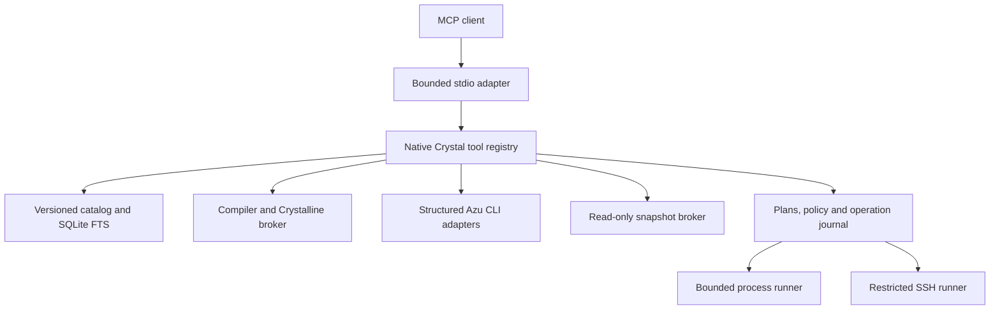

# Architecture

The protocol dependency is pinned to `spider-gazelle/mcp.cr` revision `d6ca3e5a3ad37e394af7cf91a2c0717f73cd232f`. The adapter repairs its tools-list constructor/cursor spelling, normalizes omitted optional params, and replaces the stdio transport with bounded framing and serialized writes. Protocol support is negotiated; newer clients may agree on the SDK's supported `2025-06-18` revision.

Each server admits at most eight in-flight protocol requests. Tool inputs and source reads are bounded; subprocess output is drained even after the retained prefix fills. Compiler and operation children run in separate process sessions so cancellation terminates descendants. Unknown or stale operation outcomes remain explicit.

SQLite uses WAL and an exclusive write transaction for refresh. Paths are scoped to configured roots, symlink escapes are rejected, and excluded repositories receive no dedicated indexes. Search results carry file digests and version provenance; refresh removes deleted entries.

The implementation is intentionally additive. It does not change the web HUD calculation rules, CQL subscriber topology, or the existing read-only SSH monitor.

Refresh admission is serialized across server processes with an advisory file lock. A competing refresh returns `busy` and leaves the existing index readable. Reads use a separate WAL connection; refresh yields between file batches. File digests mark changed search evidence as `stale`, and removing private-source authorization immediately prevents cached Pro results from being returned.

Operation journals admit at most 1,000 local plans and 1,000 remote plans per state directory. Archive resolved records deliberately when capacity is reached; unresolved records and replay guards are never pruned automatically. Output remains bounded to 128 KiB per subprocess stream.
